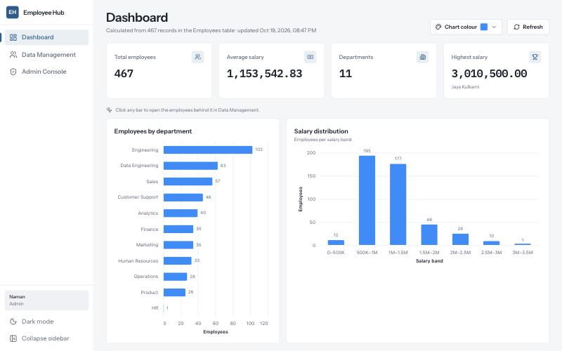
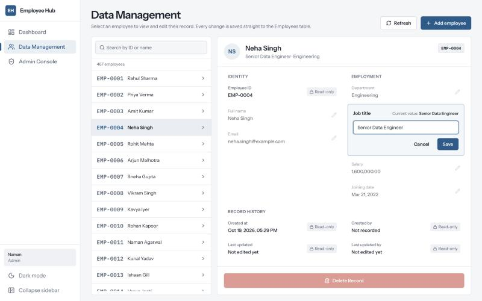
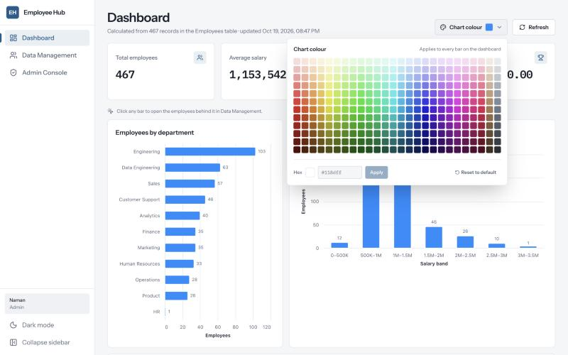
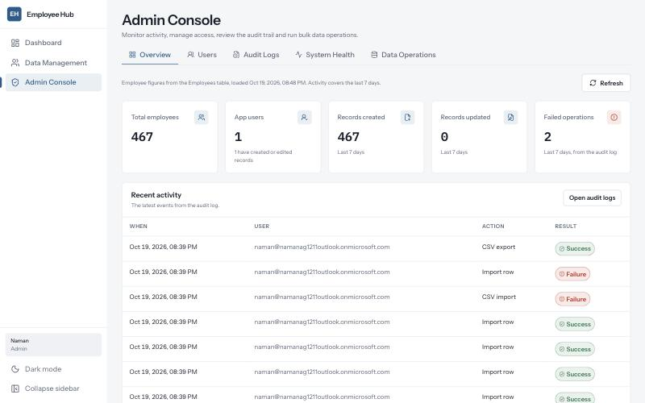
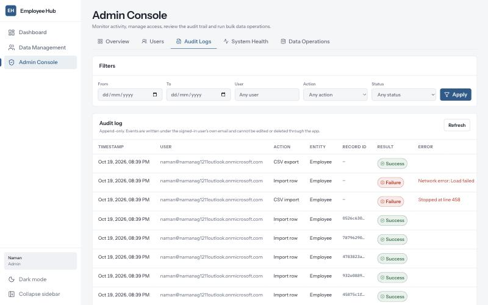
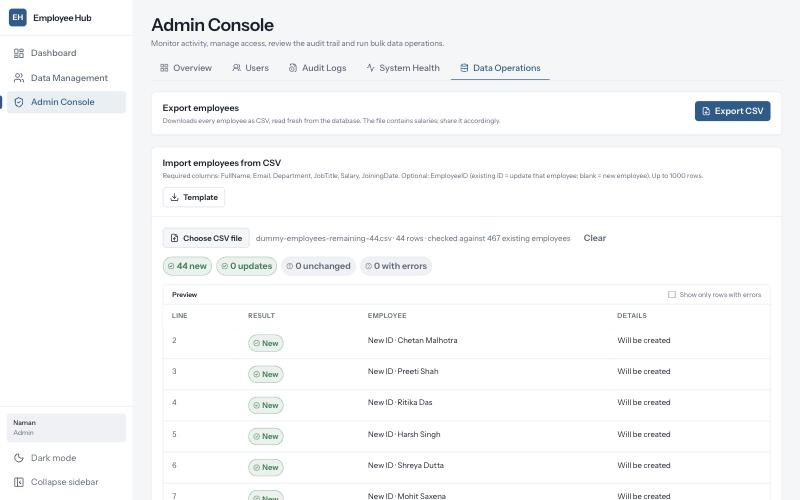

# Employee Hub

An employee management app built on **Microsoft Fabric Apps (preview)** with React, Vite and Rayfin.
Records live in the app's Fabric SQL database. Every read and write goes through the generated data API, and role-based access is enforced on the server.



## Features

- **Dashboard**: KPIs (headcount, average and highest salary, departments) and charts by department, salary band and joining month, all calculated from live records. Click any bar to open the employees behind it. A colour grid lets you choose the chart colour.
- **Data Management**: a searchable ID + name list. Each record opens a details panel where every field is edited on its own, validated, and saved by primary key. Delete needs confirmation.
- **Admin Console**:
  - **Overview**: activity KPIs and recent events.
  - **Users**: who has which role.
  - **Audit Logs**: append-only, with filters, paging and a details view.
  - **System Health**: only components that were actually checked show as verified.
  - **Data Operations**: CSV export, CSV import (preview, row-level errors, undo), and bulk delete.
- **Audit trail**: creates, edits, deletes, imports and exports are logged under the signed-in user's email, along with who created and last updated each record.

| Data Management | Chart colour |
| --- | --- |
|  |  |
| **Admin overview** | **Audit logs** |
|  |  |



## Roles

| Role | Employees | Import / export | Admin Console |
| --- | --- | --- | --- |
| Admin | Read and write | Yes | All tabs |
| HR Manager | Read and write | Yes | Data Operations |
| Viewer | Read only | No | No |

Roles live in [`packages/shared/src/access.ts`](packages/shared/src/access.ts). The data permissions are generated from that list, so the **server** refuses anything a role doesn't allow, and anyone not listed is denied. A role change takes effect after a redeploy. People also need the app shared with them in Fabric (**Run and interact**).

## Data model

Normalized tables in the Fabric SQL database:

```
Employees ──dept_id──▶ Departments
          ──title_id─▶ JobTitles
          ──createdBy_id / updatedBy_id─▶ AppUsers
AuditEvents (append-only)
```

Entities are TypeScript classes in [`packages/data/src`](packages/data/src), and Rayfin generates the tables, constraints and API from them. Example SQL for querying and two-way testing is in [`docs/sql/employee-integration-tests.sql`](docs/sql/employee-integration-tests.sql).

## Getting started

Requirements: Node.js 20, 22 or 24, and access to a Fabric workspace with capacity.

```bash
npm install
npm run dev        # signs in to Fabric and starts the app at http://localhost:5173
```

```bash
npm run typecheck && npm run build && npm run lint && npm test
```

```bash
npx rayfin up --workspace "<your workspace>"   # deploy to Fabric
```

Sample data for the importer is in [`docs/sample-data`](docs/sample-data). It's dummy data only.

## Project layout

```
packages/frontend   React UI (Dashboard, Data Management, Admin Console)
packages/data       Rayfin entities and server-side access rules
packages/shared     Browser-safe types and the role list
rayfin/rayfin.yml   Fabric services: auth, data, static hosting
docs/               SQL examples, sample CSVs, screenshots
```

## Data platform

[`data-platform/`](data-platform/) holds the analytics side: an incremental + CDC pipeline from this app's database into a star schema and a Power BI semantic model. See its [architecture](data-platform/README.md).

## Known limitations

- Role changes require a redeploy, because the platform has no per-user role claim.
- The data API has no multi-row transactions. Imports validate everything first, stop at the first failed write, and offer an undo.
- Field visibility can't vary per user, so Viewers can see salaries.
