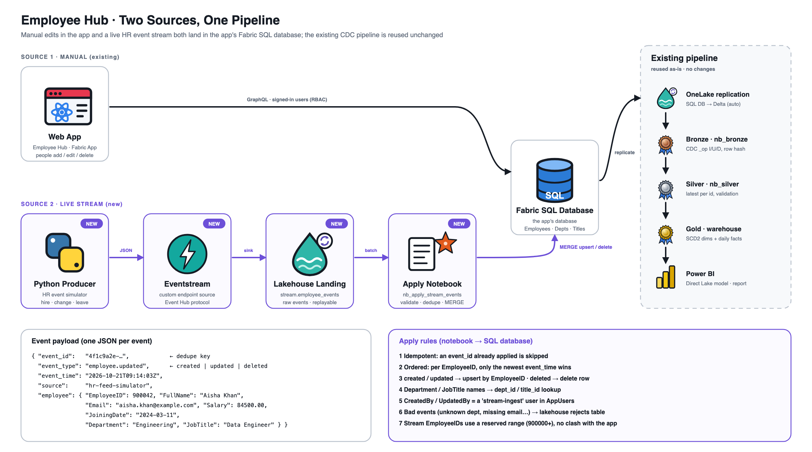

# Employee Hub · Data Platform

An incremental + CDC pipeline in Microsoft Fabric. It takes the Employee Hub app's operational data, cleans it, models it as a star schema, and serves it through a Power BI semantic model.

> **Built.** The Fabric items (lakehouse, notebooks, pipeline, warehouse, semantic model and report) live in their own repo, [employee-hub-data-platform](https://github.com/namanagarwal121/employee-hub-data-platform). It's included here as a submodule at [`fabric/`](fabric/).
> **Start here:** [step-by-step setup guide](docs/setup-guide.md).


<sub>Source: [`docs/architecture.svg`](docs/architecture.svg)</sub>

## Flow

1. **Source.** The Employee Hub app writes to its Fabric SQL database (`app-new`) through the role-enforced data API. The `AuditEvents` table records every create, update, delete and import.
2. **Change capture.** The SQL database is replicated to OneLake as Delta tables (read through its SQL analytics endpoint), so the pipeline never queries the app's database directly. A Spark notebook pulls only rows changed since the last run (`CreatedAt` / `UpdatedAt` greater than the watermark) and detects deletes from `AuditEvents`.
3. **Bronze.** Raw, append-only copies of each table, with `_ingested_at`, `_source_ts` and `_op` (I / U / D) columns, so any run can be replayed.
4. **Silver.** Cleaned and conformed data:
   - Department names are unified (for example `HR` → `Human Resources`), text is trimmed and its case normalized, and only the latest version of each record is kept.
   - Type and range checks run on every row; rows that fail go to `silver_rejects`.
5. **Gold.** A star schema: `DimEmployee` (SCD Type 2, so the full history of each employee's changes is kept), `DimDepartment`, `DimJobTitle`, `DimDate`, `FactHeadcountMonthly` and `FactEmployeeChange`.
6. **Serving.** A Power BI semantic model in Direct Lake mode over Gold, with measures such as headcount, hires and leavers, attrition, and average and maximum salary.

A Data Factory pipeline runs the steps on a schedule. It reads the watermark, runs bronze → silver → data-quality checks → gold, refreshes the semantic model, and logs the run to `pipeline_runs`.

## Layout

```
data-platform/
  docs/       architecture diagrams and setup guide
  fabric/     submodule: employee-hub-data-platform (Fabric Git integration)
  streaming/  producer/: the Python HR event simulator
```

To clone the app with the Fabric items included:

```bash
git clone --recurse-submodules https://github.com/namanagarwal121/employee-hub-fabric-app.git
```

## Second source: a live HR event stream

The app's database now has two writers: people using the app, and a live stream of HR events. Both land in the same SQL database, so the pipeline above is reused unchanged.



<sub>Source: [`docs/streaming-architecture.svg`](docs/streaming-architecture.svg)</sub>

1. **Producer.** [`streaming/producer`](streaming/producer/) is a Python HR simulator. It sends one JSON event per hire, salary change, promotion, transfer, name change or leaver to a Fabric **Eventstream** custom endpoint. It can also send invalid, duplicate and out-of-order events for testing.
2. **Landing.** The Eventstream writes raw events to the lakehouse table `dbo.employee_events`.
3. **Stream bronze.** The `Stream_notebook_bronze` notebook reads only new landing rows and keeps one row per `event_id`. It types and flattens each event and flags invalid ones with a reason instead of dropping them.
4. **SQL-ready tables.** The same notebook compares each stream employee's newest valid event with the app's current row. It writes only the differences to `sql_ready`, one table per app table: inserts, updates, deletes and audit rows, plus a `rejects` table. Reruns never repeat a change, stale events never win, and newer edits made in the app are kept.
5. **Apply.** These tables are copied into a `stream_stage` schema in the app's database. There, `sp_apply_stream_changes` applies them in one transaction and logs each run ([setup script](fabric/sql_database/stream_stage_setup.sql)).

**Status.** Steps 1–4 are built. The notebook was tested end to end on local Spark with simulated landing and app tables. The setup script has been run in the app's database. The final step still needs wiring into the pipeline, because it needs the pipeline's connection to the app's SQL database.
