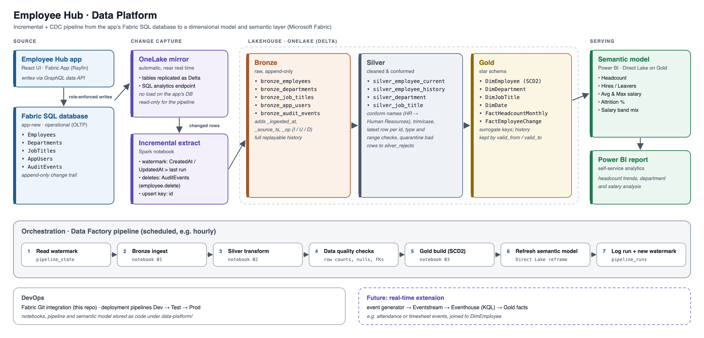

# Employee Hub · Data Platform

An incremental + CDC pipeline in Microsoft Fabric. It takes the Employee Hub app's operational data, cleans it, models it as a star schema, and serves it through a Power BI semantic model.

> **Status: design.** This folder holds the architecture. Notebooks, the pipeline and the semantic model will be added here as they are built.



<sub>Source: [`docs/architecture.svg`](docs/architecture.svg)</sub>

## Flow

1. **Source.** The Employee Hub app writes to its Fabric SQL database (`app-new`) through the role-enforced data API. The `AuditEvents` table records every create, update, delete and import.
2. **Change capture.** The SQL database is replicated to OneLake as Delta tables (read through its SQL analytics endpoint), so the pipeline never queries the app's database directly. A Spark notebook pulls only rows changed since the last run (`CreatedAt` / `UpdatedAt` greater than the watermark) and detects deletes from `AuditEvents`.
3. **Bronze.** Raw, append-only copies of each table, with `_ingested_at`, `_source_ts` and `_op` (I / U / D) columns, so any run can be replayed.
4. **Silver.** Cleaned and conformed data:
   - Department names are unified (for example `HR` → `Human Resources`), text is trimmed and its case normalized, and only the latest version of each record is kept.
   - Type and range checks run on every row; rows that fail go to `silver_rejects`.
5. **Gold.** A star schema: `DimEmployee` (SCD Type 2, so the full history of each employee's changes is kept), `DimDepartment`, `DimJobTitle`, `DimDate`, `FactHeadcountMonthly` and `FactEmployeeChange`.
6. **Serving.** A Power BI semantic model in Direct Lake mode over Gold, with measures such as headcount, hires and leavers, attrition, and average and maximum salary.

A Data Factory pipeline runs the steps on a schedule. It reads the watermark, runs bronze → silver → data-quality checks → gold, refreshes the semantic model, and logs the run to `pipeline_runs`.

## Planned layout

```
data-platform/
  docs/          architecture diagram and design notes
  notebooks/     01_bronze_ingest, 02_silver_transform, 03_gold_dimensional
  pipelines/     Data Factory pipeline definition
  sql/           checks and validation queries
  semantic-model/  Power BI semantic model (TMDL)
```

## Later: real-time extension

A generator streams attendance or timesheet events through Eventstream into an Eventhouse (KQL). They're joined to `DimEmployee` and added as facts in Gold.
